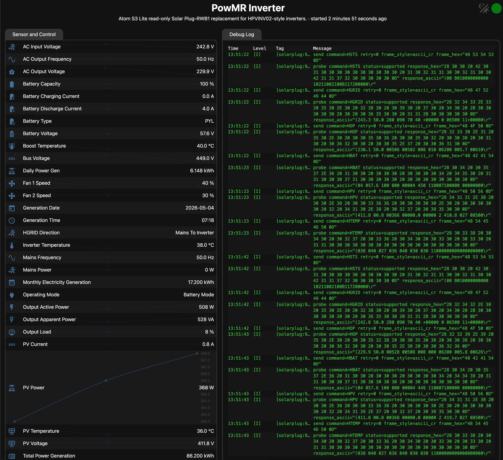

# solarplug-esphome

ESPHome external component and decoder tools for local replacement of Solar Plug / Solar of Things RS232 Wi-Fi dongles on compatible HPVINV02-style inverters.

This project was developed from passive serial captures and active probes on a PowMr / MrPow `POW-HVM6.2KP` inverter reporting `HPVINV02`, `VMII-6200`, and firmware/software `40.05`. The original dongle used for sniffing was `WIFI-RELAB`.

Search terms: Solar Plug-RWB1, RWB1-06R, WIFI-RELAB, Solar of Things, HPVINV02, PowMr, MrPow, Relab, Datouboss, TECHFINE, HVM6.2KP, HVM11KP, VMII-6200, ESPHome.



## What Works

The component is read-only by default. It polls the same H-command telemetry family observed from the original dongle and publishes stable ESPHome entities:

- inverter status and operating mode
- AC input/output voltage, frequency, power, and load
- battery voltage, SOC, charge/discharge current, and bus voltage
- PV voltage/current/power
- inverter temperatures and fan speeds
- native daily/monthly/yearly/total PV generation counters from `HGEN`
- protocol identity and firmware strings

Diagnostic blocks such as `HBMS*` (the BMS limits the inverter receives), `HPVB`, `HEEP3` and the raw payloads are available as diagnostic entities. The read-only examples send no setters.

The separate beta profile (`packages/solarplug-write-beta.yaml`) exposes write controls:

- **Controls:** 14 numbers, 11 switches and 8 selects, covering charge currents, priorities, battery voltages, equalization, dual output and the PI30 flags. Every value an entity offers is one its encoder accepts, given a valid ordering against the other SOC thresholds; the parity test checks that.
- **Unsafe opt-in** (`packages/solarplug-write-unsafe.yaml`, `write_profile: unsafe`, every entity disabled by default): 10 numbers, 4 switches and 4 selects. They cover the NAK-only voltage thresholds, dual output mode, switching the second output on/off, grid feed, CT, output frequency/voltage/mode, grid protocol, and the AC charge/output time windows. They are NAK-only on this unit (`PSDV`, `PBFT`, `PSLV`, `PDSDV`, `PDSRV`) or have never been sent; most come from the vendor tool.
- **Readback:** every control shows the inverter's real value. It is seeded from the `HEEP1`/`HEEP2` settings snapshots, the CRC-framed PI30 queries `QPIRI`, `QFLAG` and `QBEQI`, and `HSTS` for the second output. It is updated only after the inverter ACKs a write.
- **Upgrade note:** three sliders became selects with the same names:
  - `maximum_charging_current` and `maximum_mains_charging_current` now offer the inverter's announced values. Options adopted at runtime reach HA at its next reconnect.
  - `battery_redischarge_voltage` now offers `Full` and 48–58 V.

  An automation calling `number.set_value` on them needs `select.select_option` with an option such as `"30 A"`.
- **Integrity:** with `response_crc: true` (default in the full-reader package), every reply is CRC-checked: PI30 replies always, H replies through a `HOSTCRCEN` keep-alive. The Response CRC sensor shows the state.
- **Diagnostics:** the `probe_read` / `probe_write` API actions send one allow-listed query (or `HOSTCRCEN`/`HOSTCRCDN`) and show the raw reply on Probe Result ([H_COMMANDS.md](docs/protocol/H_COMMANDS.md)).
- **References:** see [docs/protocol/HEEP_SETTINGS_MAP.md](docs/protocol/HEEP_SETTINGS_MAP.md) and [docs/protocol/WRITE_SURFACE.md](docs/protocol/WRITE_SURFACE.md).

Status decodes:
- fault code, inverter alarms, front-panel LEDs, grid-tie state, main and second output relays, parallel units/role;
- dual output mode and the raw time-window slots (`HEEP2[0]`, `[11]`, `[12]`, `[14]`);
- BMS status and temperature, charge switches, fan enable;
- rated powers (`HIMSG2`) and the inverter's own allowed charge-current lists (`QMCHGCR`/`QMUCHGCR`).

Field positions come from round-trips on this unit and from the vendor PC tool `zhuaibai/TQF-AllInOne` (HPVINV02 screen). Each entity's evidence grade is in [HEEP_SETTINGS_MAP.md](docs/protocol/HEEP_SETTINGS_MAP.md).

The full reader also publishes bus-profiling sensors (utilization, response time, timeouts, frame errors, NAKs) and the output voltage, frequency and AC output mode as sensors. These three are writable only in the unsafe profile.

### Breaking changes on branch `bms-limits-heep-fields` (2026-11-16)

- **HTEMP temperature and fan sensors were rotated.** Before, "Inverter Temperature" showed the PV temperature and "Fan 1 Speed" showed the max temperature. Recorder history before this date mixes the old meanings.
- **`battery_type` now reads `HEEP1[3]` d2**, the inverter's battery-type setting. Before, it read `HBAT[0]`, which is the 12 V series count and always reported "PYL" on 48 V systems.
- **Settings readback moved to a separate `settings_poll_interval`** (default 5 min), split from `identity_poll_interval`.
- **Three number entities became selects** (see the upgrade note above).
- **This branch needs its own component.** The examples still pin `github://kOld/solarplug-esphome@main`, which lacks `response_crc`, `settings_poll_interval` and `solarplug_writes.*`. Point `ref:` and `external_components` at this branch until it is merged.

## Compatibility

Confirmed:

| Inverter | Dongle | Status |
|---|---|---|
| `POW-HVM6.2KP` | `WIFI-RELAB` | confirmed replacement on fw 40.05; most beta writes round-trip verified (see WRITE_TEST_LEDGER.md) |

Likely compatible but unverified because they are listed for the same `WIFI-RELAB` module:

- `POW-HVM11KP`
- `POW-RELAB 3KU`
- `POW-RELAB 3KE`
- `POW-RELAB 5KU`
- `POW-RELAB 5KE`
- `POW-RELAB 10KU`
- `POW-RELAB 10KE`
- `POW-RELAB SPLIT Series`

See [docs/protocol/COMPATIBILITY.md](docs/protocol/COMPATIBILITY.md) for the full model matrix and how to submit redacted captures for another inverter.

## Wiring

Use the inverter port labeled `RS232` or `COM`. Solar Assistant documents the PowMr HVM KP-series RJ45 pinout as pin 3 = inverter RX, pin 4 = GND, and pin 6 = inverter TX. The POW-HVM6.2KP manual also lists pin 5 as GND, while field reports for this exact model use pin 2/4 as voltage rails for small interface modules. For this project, use pin 4 as ground, optionally tie pin 5 to the same RS232 adapter ground, and leave pin 2 disconnected unless you have verified your exact inverter/cable.


Do not connect the inverter RS232 port directly to ESP32 GPIO. ESP32 TX/RX must go through a MAX3232-style RS232 transceiver, an RS232 base, or a known-compatible USB RS232 cable. See [docs/hardware/RS232_WIRING.md](docs/hardware/RS232_WIRING.md) for the pin table and cable notes. Image source: [Solar Assistant PowMr HVM KP-series RS232 guide](https://solar-assistant.io/help/inverters/powmr/POW-HVM-KP/rs232).

## Install

Use ESPHome external components:

```yaml
external_components:
  - source: github://kOld/solarplug-esphome@main
    components: [solarplug]
    refresh: 1d
```

Reusable entity packages are also available:

```yaml
packages:
  solarplug_reader: github://kOld/solarplug-esphome/packages/solarplug-read-full.yaml@main
```

## Minimal Active Reader

Use active mode only when the original Solar Plug is disconnected and the ESP32 is the only RS232 master.

```yaml
uart:
  id: uart_main
  tx_pin: GPIO17
  rx_pin: GPIO16
  baud_rate: 2400
  data_bits: 8
  parity: NONE
  stop_bits: 1

solarplug:
  id: solarplug_reader
  uart_id: uart_main
  passive_mode: false
  sensors:
    output_active_power: { name: Output Active Power }
    battery_voltage: { name: Battery Voltage }
    pv_power: { name: PV Power }
    total_power_generation: { name: Total Power Generation }
  text_sensors:
    operating_mode: { name: Operating Mode }
```

Complete examples are in `examples/`.

The examples keep board, Wi-Fi, API, OTA, web server, and UART wiring in the device YAML. The Solar Plug entity surface lives in `packages/` so users can include the full reader package, a minimal reader package, the passive sniffer package, or layer the beta write package on top. ESPHome package merging allows local configs to override, extend, or remove individual entities without copying the whole component block.

The Atom S3 Lite replacement example uses ESPHome's `esp-idf` framework. The component does not depend on Arduino APIs, and the pure ESP-IDF build avoids a certificate-generation failure seen with the mixed Arduino/ESP-IDF toolchain in ESPHome 2026.1.2.

The beta write example is separate: `examples/atom-s3-lite-write-beta.yaml`. It requires `enable_writes: true` and `write_profile: beta`. The unsafe package needs `write_profile: unsafe`, and no example includes it.

Raw UART frame logs and decoded per-field logs are opt-in (`raw_frame_logging` and `decoded_field_logging`). Keep both off in normal firmware; enable them only for capture/replay work where the extra log formatting and network log traffic are useful.

## Safety

RS232 is a single-master path. Do not connect the original Solar Plug and an active ESPHome reader as simultaneous masters.

The component's defaults (`passive_mode: true`) send nothing. The read packages send only read queries, plus the `HOSTCRCEN` keep-alive in the full reader. Setters need `enable_writes: true` and a write profile (the `sync_clock` button and `probe_write` need only `enable_writes`), and there is no arbitrary command sender. Details are in [SECURITY.md](SECURITY.md).

## Documentation

In reading order:

1. [docs/hardware/RS232_WIRING.md](docs/hardware/RS232_WIRING.md): wiring the ESP to the inverter.
2. [docs/COMPONENT_DESIGN.md](docs/COMPONENT_DESIGN.md): poll tiers, framing, reply checking, write safety, tests.
3. [docs/protocol/H_COMMANDS.md](docs/protocol/H_COMMANDS.md): the protocol: commands, replies, response CRC, probes, field notes.
4. [docs/protocol/HEEP_SETTINGS_MAP.md](docs/protocol/HEEP_SETTINGS_MAP.md): every setting, with its frame, readback slot and evidence.
5. [docs/protocol/WRITE_SURFACE.md](docs/protocol/WRITE_SURFACE.md): setter capture history, and why controls are in the unsafe profile.
6. [docs/protocol/WRITE_TEST_LEDGER.md](docs/protocol/WRITE_TEST_LEDGER.md): every write round-trip.
7. [docs/LCD_VALIDATION_CHECKLIST.md](docs/LCD_VALIDATION_CHECKLIST.md): what to confirm on the inverter screen.
8. [docs/protocol/HGEN_ROLLOVER.md](docs/protocol/HGEN_ROLLOVER.md): energy-counter resets.
9. [docs/protocol/COMPATIBILITY.md](docs/protocol/COMPATIBILITY.md): other models.

## Development

Run decoder tests:

```bash
python3 -m unittest tests.test_decode_h_protocol   # Python reference + host-compiled firmware codec and encoders (C++17)
```

```bash
python3 tools/validate_examples.py                 # esphome config on every example against this checkout
```

The repository intentionally excludes local ESPHome build output, secrets, raw private capture corpora, and cloud account tooling. Keep public fixtures synthetic or redacted.

## Status

The replacement is beta quality on the confirmed PowMr/MrPow HPVINV02 setup (fw 40.05), reads and writes included. Models listed for the same `WIFI-RELAB` module are likely compatible, but must be validated with captures before being listed as confirmed.
